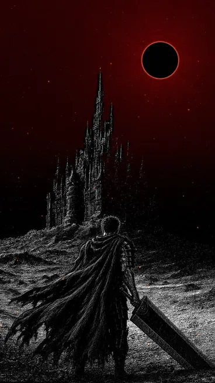
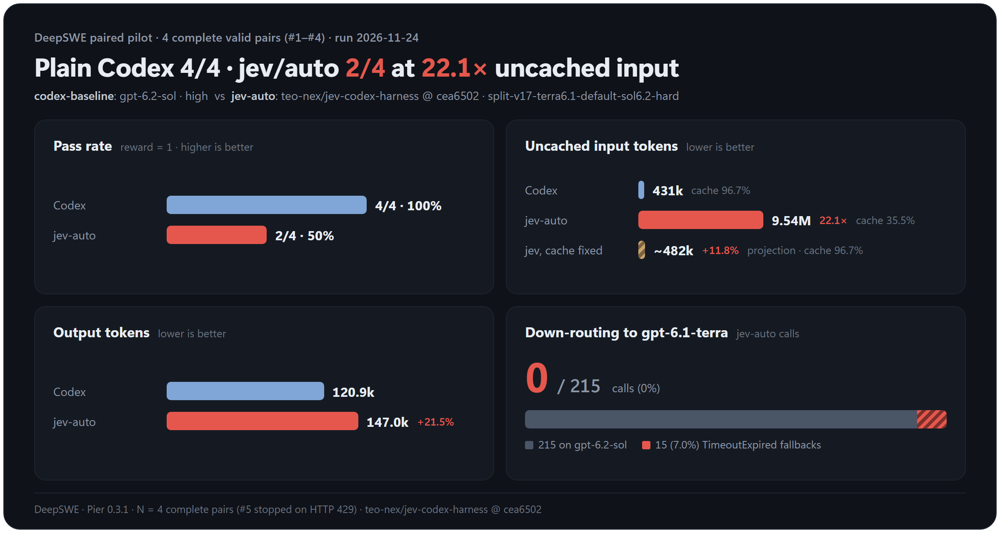
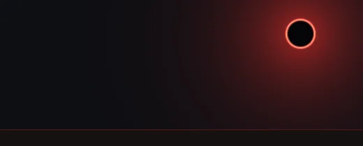

<b>EN</b> · <a href="./README.ru.md">RU</a>

# hvvze

I build AI agents, evaluation harnesses, and web tools end-to-end — from prototype to deployed product.

Current focus: **AIFRND × AIView**, **AIMTHFR**, and **Astra + Jev** benchmarks.

**Focus:** AI agents & workflows · evals & browser automation · web apps & Chrome extensions 
**Workflow:** AI-native development — T3 Code · Claude · Gemini · GPT · DeepSeek

 

## What I'm building

<table>
<tr>
<td width="80" align="center"></td>
<td>
<h3>AIFRND × AIView · live</h3>

AI workflow for interior businesses, from the first customer conversation to a visual brief. AIFRND qualifies the lead and gathers requirements; AIView turns the brief and references into interior visuals.

<a href="https://aifrnd.org/">Explore the project ↗</a>

</td>
</tr>
<tr>
<td width="80" align="center"></td>
<td>
<h3>AIMTHFR · in development</h3>

Autonomous AI sales and chat operator for creator CRM platforms: handles multi-turn conversations, tracks dialogue context, and supports seamless operator handoff directly inside the CRM.

<a href="https://t.me/ilovemymoggedlife">Ask me about AIMTHFR ↗</a>

</td>
</tr>
</table>

## Benchmarks & experiments

<table>
<tr>
<td width="80" align="center"></td>
<td>
<h3>Astra + Jev Benchmark · public harness · React pilot</h3>

Reproducible evaluation harness measuring how bounded <strong>Jev</strong> orchestration affects frontier coding models (<strong>Astra</strong> &amp; <strong>Sol 6.1</strong>) on full-stack React builds, bug-fixing, and local browser tasks.

<strong>React website pilot (Oct 2026):</strong> 20 scored runs (<code>xhigh</code>, 900s budget) validated by 18 automated build &amp; browser checks (filters, pricing, form validation, keyboard focus, mobile widths, reduced motion, runtime errors). Harness, logs, and all generated builds are public.

<a href="https://github.com/hqvdvn-cmd/astra-jev-benchmark">Explore the benchmark ↗</a> · <a href="https://hqvdvn-cmd.github.io/astra-jev-benchmark/gallery/">Live site gallery</a> · <a href="https://github.com/hqvdvn-cmd/astra-jev-benchmark/blob/main/RESULTS.md">Results</a>

</td>
</tr>
</table>

### Other public projects

**Open to AI engineering / product builder roles, contract work, and interesting collaborations.** 
Reach out on Telegram: [@ilovemymoggedlife](https://t.me/ilovemymoggedlife).
