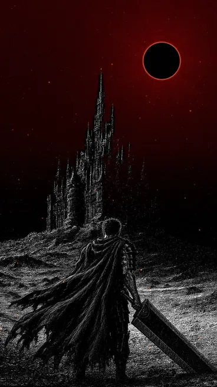

<a href="./README.md">EN</a> · <b>RU</b>

# hvvze

Строю ИИ-агентов, харнессы для оценки моделей и веб-инструменты под ключ — от прототипа до задеплоенного продукта.

Сейчас в фокусе: **AIFRND × AIView**, **AIMTHFR** и бенчмарк **Astra + Jev**.

**Фокус:** ИИ-агенты и пайплайны · evals и браузерная автоматизация · веб-приложения и Chrome-расширения 
**Workflow:** AI-native разработка — T3 Code · Claude · Gemini · GPT · DeepSeek

 

## Что я строю

<table>
<tr>
<td width="80" align="center"></td>
<td>
<h3>AIFRND × AIView · live</h3>

ИИ-пайплайн для интерьерного бизнеса: от первого диалога с клиентом до визуального брифа. AIFRND квалифицирует заявку и собирает требования, а AIView превращает бриф и референсы в визуал.

<a href="https://aifrnd.org/">Открыть проект ↗</a>

</td>
</tr>
<tr>
<td width="80" align="center"></td>
<td>
<h3>AIMTHFR · в разработке</h3>

Автономный AI sales/chat-оператор для creator CRM-платформ: ведёт многоходовые диалоги, удерживает контекст и поддерживает плавную передачу чата живому оператору прямо внутри CRM.

<a href="https://t.me/ilovemymoggedlife">Спросить про AIMTHFR ↗</a>

</td>
</tr>
</table>

## Бенчмарки и эксперименты

<table>
<tr>
<td width="80" align="center"></td>
<td>
<h3>Astra + Jev Benchmark · парный пилот DeepSWE · ноябрь 2026</h3>

Парное сравнение чистого Codex CLI (<code>gpt-6.2-sol</code>, <code>high</code>) и <a href="https://github.com/teo-nex/jev-codex-harness"><code>teo-nex/jev-codex-harness</code></a> (<code>cea6502</code>, <code>split-v17-terra6.1-default-sol6.2-hard</code>). Автор харнесса — <strong>Teo | Nexcore (<a href="https://github.com/teo-nex">@teo-nex</a>)</strong>. Обе ветки решали одни и те же реальные задачи DeepSWE в изолированных Docker-контейнерах без сети.

<strong>4 полные пары (2026-11-24):</strong> чистый Codex решил 4 из 4, <code>jev/auto</code> — 2 из 4. У <code>jev/auto</code> кэш-хит упал с 96.7% до 35.5%, некэшированный вход вырос в 22.1 раза (431k → 9.54M), и ни один из 215 вызовов не ушёл в дешёвую <code>gpt-6.1-terra</code>. Задача #5 остановилась на HTTP 429.

<a href="https://github.com/hqvdvn-cmd/astra-jev-benchmark/blob/main/README.ru.md">Открыть бенчмарк ↗</a> · <a href="https://github.com/hqvdvn-cmd/astra-jev-benchmark/blob/main/evidence/2026-11-24-deepswe-pilot-10-v1/summary.md">Сводка</a> · <a href="https://github.com/teo-nex/jev-codex-harness">jev-codex-harness</a>

</td>
</tr>
</table>

### Другие открытые проекты

**Открыт к предложениям по работе (AI engineering / product builder), проектной разработке и интересным задачам.** 
Пиши в Telegram: [@ilovemymoggedlife](https://t.me/ilovemymoggedlife).
