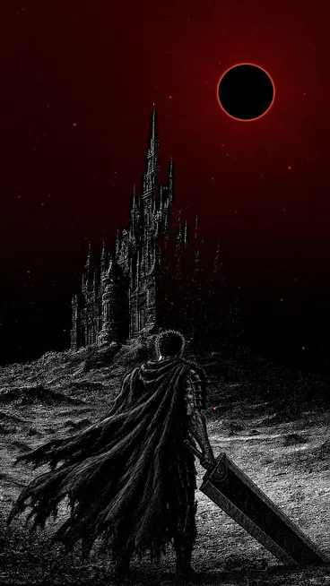
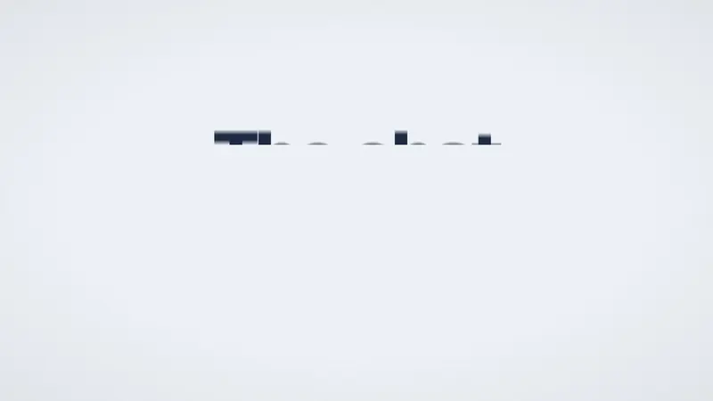
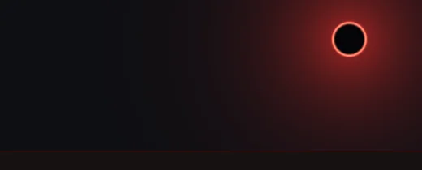

<a href="./README.md">EN</a> · <b>RU</b>

# hvvze

Большую часть времени я строю ИИ-агентов и инструменты вокруг них. Ещё работаю над Web3-проектами и выкладываю эксперименты, когда есть чем поделиться.

Сейчас в фокусе: **AIFRND × AIView**, **AIMTHFR** и замеры того, как работают вместе **Astra + Jev**.

**Мой верстак** 
только T3 Code 
GPT · Kimi · DeepSeek · Krea2 · Seedance 2.5 · MiniMax H3

 

## Что я строю

<table>
<tr>
<td width="80" align="center"></td>
<td>
<h3>AIFRND × AIView</h3>

ИИ для интерьерного бизнеса: от первого разговора с клиентом до визуального брифа. AIFRND собирает требования и квалифицирует заявку, AIView превращает бриф и референсы в визуал.

<a href="https://aifrnd.org/">Открыть проект ↗</a>

</td>
</tr>
<tr>
<td width="80" align="center"></td>
<td>
<h3>AIMTHFR · в разработке</h3>

Делаю полноценного ИИ-чаттера для OnlyFans и Fansly: ИИ-оператора, который сам ведёт переписку. AIMTHFR в разработке.

<a href="https://t.me/ilovemymoggedlife">Спросить про AIMTHFR ↗</a>

</td>
</tr>
</table>

## Бенчмарки и эксперименты

<table>
<tr>
<td width="80" align="center"></td>
<td>
<h3>Astra + Jev · готовится крупный апдейт</h3>

Я собрал бенчмарк, чтобы проверить, как Jev меняет результаты Astra на задачах по коду, багфиксу и локальному браузеру. Пять режимов сравнивают Astra в одиночку с решениями и ревью при помощи Jev.

🛠 <strong>Новая версия на подходе:</strong> заметно более жёсткий бенчмарк и гораздо больше разнообразия в задачах. Текущие результаты ниже относятся к первому раунду.

<strong>45 попыток</strong> · успешность задач, время, токены и примерная стоимость API. Харнесс, результаты и обезличенные записи открыты.

<a href="https://github.com/hqvdvn-cmd/astra-jev-benchmark">Открыть бенчмарк ↗</a> · <a href="https://github.com/hqvdvn-cmd/astra-jev-benchmark/blob/main/RESULTS.md">Результаты</a>

</td>
</tr>
</table>

### Другие открытые проекты

Инструменты для чатов Fansly, компаньон-Гатс для Codex, iwannabeimp и [Dota 2 → Deadlock](https://github.com/hqvdvn-cmd/dota2todeadlock): иконки и эффекты предметов из Доты в Deadlock.

**Проект, эксперимент или хороший сайд-квест?** 
Пиши в Telegram: [@ilovemymoggedlife](https://t.me/ilovemymoggedlife).
