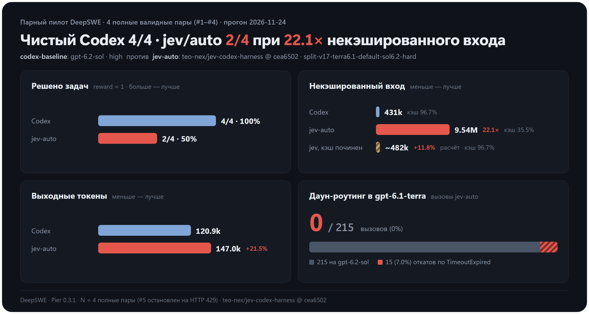
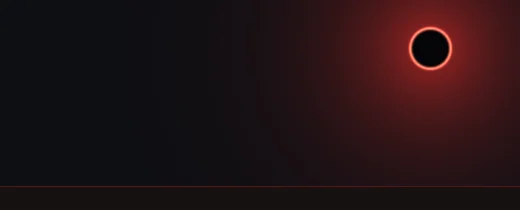

<a href="./README.md">EN</a> · <b>RU</b>

# hvvze

Строю ИИ-агентов, харнессы для оценки моделей и веб-инструменты под ключ — от прототипа до задеплоенного продукта.

Сейчас в фокусе: **AIFRND × AIView**, **AIMTHFR** и бенчмарк **Astra + Jev**.

**Фокус:** ИИ-агенты и пайплайны · evals и браузерная автоматизация · веб-приложения и Chrome-расширения 
**Workflow:** AI-native разработка — T3 Code · Claude · Gemini · GPT · DeepSeek

 

## Что я строю

<table>
<tr>
<td width="80" align="center"></td>
<td>
<h3>AIFRND × AIView · live</h3>

ИИ-пайплайн для интерьерного бизнеса: от первого диалога с клиентом до визуального брифа. AIFRND квалифицирует заявку и собирает требования, а AIView превращает бриф и референсы в визуал.

<a href="https://aifrnd.org/">Открыть проект ↗</a>

</td>
</tr>
<tr>
<td width="80" align="center"></td>
<td>
<h3>AIMTHFR · в разработке</h3>

Автономный AI sales/chat-оператор для creator CRM-платформ: ведёт многоходовые диалоги, удерживает контекст и поддерживает плавную передачу чата живому оператору прямо внутри CRM.

<a href="https://t.me/ilovemymoggedlife">Спросить про AIMTHFR ↗</a>

</td>
</tr>
</table>

## Бенчмарки и эксперименты

<table>
<tr>
<td width="80" align="center"></td>
<td>
<h3>Astra + Jev Benchmark · открытый харнесс · React-пилот</h3>

Воспроизводимый бенчмарк, проверяющий, как ограниченная оркестрация <strong>Jev</strong> влияет на результаты кодинговых моделей (<strong>Astra</strong> и <strong>Sol 6.1</strong>) на сборке React-сайтов, багфиксе и локальных браузерных задачах.

<strong>React-пилот (октябрь 2026):</strong> 20 зачётных прогонов (<code>xhigh</code>, бюджет 900с) с 18 автоматическими проверками сборки и браузера (фильтры, прайсинг, валидация форм, фокус с клавиатуры, мобильные экраны, reduced motion, ошибки рантайма). Харнесс, логи и все собранные сайты открыты.

<a href="https://github.com/hqvdvn-cmd/astra-jev-benchmark">Открыть бенчмарк ↗</a> · <a href="https://hqvdvn-cmd.github.io/astra-jev-benchmark/gallery/">Галерея сайтов</a> · <a href="https://github.com/hqvdvn-cmd/astra-jev-benchmark/blob/main/RESULTS.md">Результаты</a>

</td>
</tr>
</table>

### Другие открытые проекты

**Открыт к предложениям по работе (AI engineering / product builder), проектной разработке и интересным задачам.** 
Пиши в Telegram: [@ilovemymoggedlife](https://t.me/ilovemymoggedlife).
